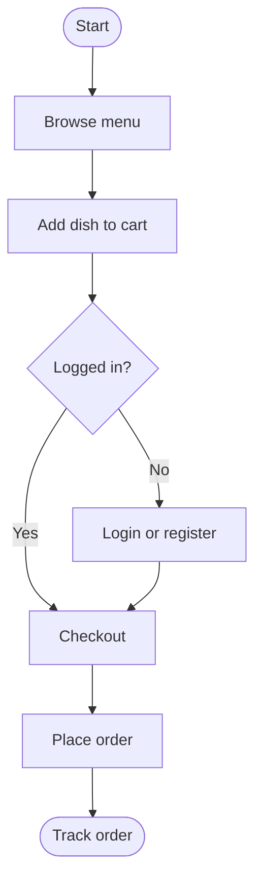

<!--
FILE      : docs/design/activity-diagram.md
DEPI ITEM : System Analysis & Design - Activity Diagram
OWNER     : Shorouk (suggested - change if the team reassigns)
DUE       : 6 Nov 2026
WHAT TO DO:
  1. Required only if the instructor asks. Draw the workflow of ordering (browse -> cart -> login -> checkout -> track).
Delete this comment block when the file is done.
-->

# Activity Diagram

TODO: add decisions for unavailable dishes and declined payment.
