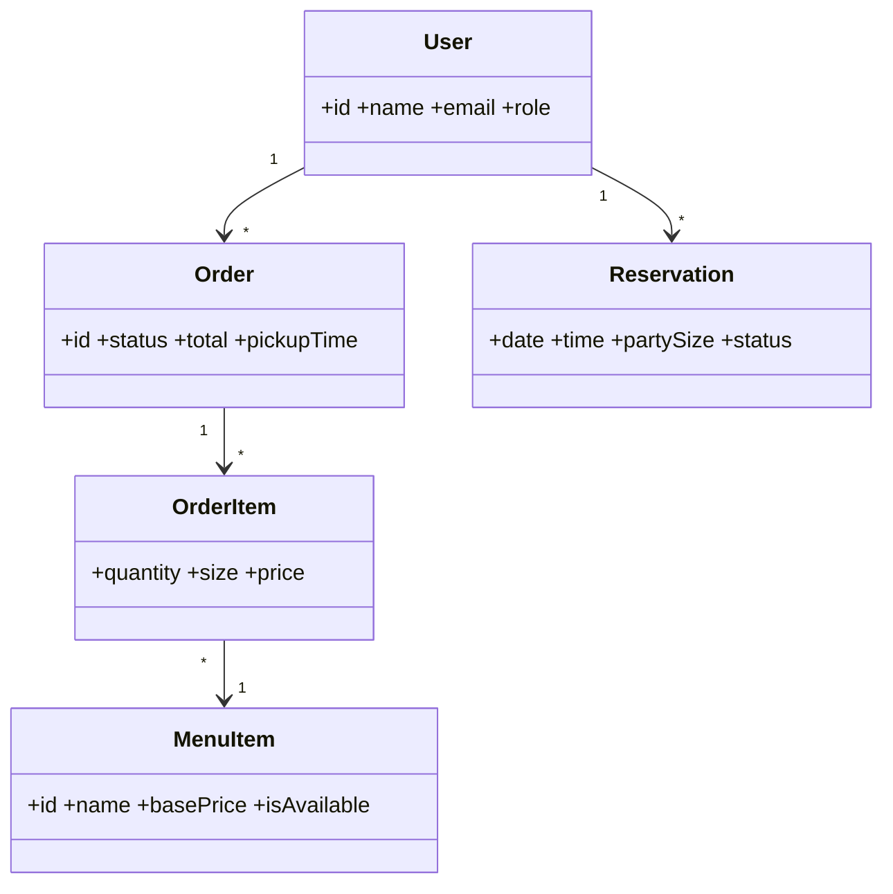

<!--
FILE      : docs/design/class-diagram.md
DEPI ITEM : System Analysis & Design - Class Diagram
OWNER     : Ahmed Emad (suggested - change if the team reassigns)
DUE       : 6 Nov 2026
WHAT TO DO:
  1. Required only if the instructor asks.
  2. Base it on the models in docs/design/erd.md: User, Category, MenuItem, Order, OrderItem, Reservation (attributes, methods, relationships).
Delete this comment block when the file is done.
-->

# Class Diagram

TODO: add methods and the remaining classes.
