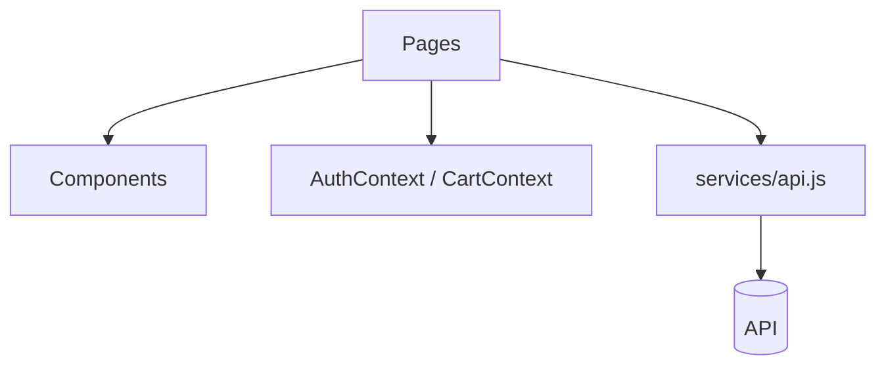

<!--
FILE      : docs/design/component-diagram.md
DEPI ITEM : System Analysis & Design - Component Diagram
OWNER     : Ahmed Emad (suggested - change if the team reassigns)
DUE       : 6 Nov 2026
WHAT TO DO:
  1. Required only if the instructor asks.
  2. Show the main components (pages, shared components, contexts, services) and their dependencies.
Delete this comment block when the file is done.
-->

# Component Diagram

TODO: refine with the real components.
