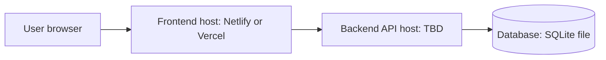

<!--
FILE      : docs/design/deployment-diagram.md
DEPI ITEM : System Analysis & Design - Deployment Diagram
OWNER     : Ahmed Emad (suggested - change if the team reassigns)
DUE       : 6 Nov 2026
WHAT TO DO:
  1. Required only if the instructor asks.
  2. Show where each part runs: user's browser, frontend host (Netlify/Vercel), backend host, database.
Delete this comment block when the file is done.
-->

# Deployment Diagram

TODO: replace TBD with the real hosting once decided.
