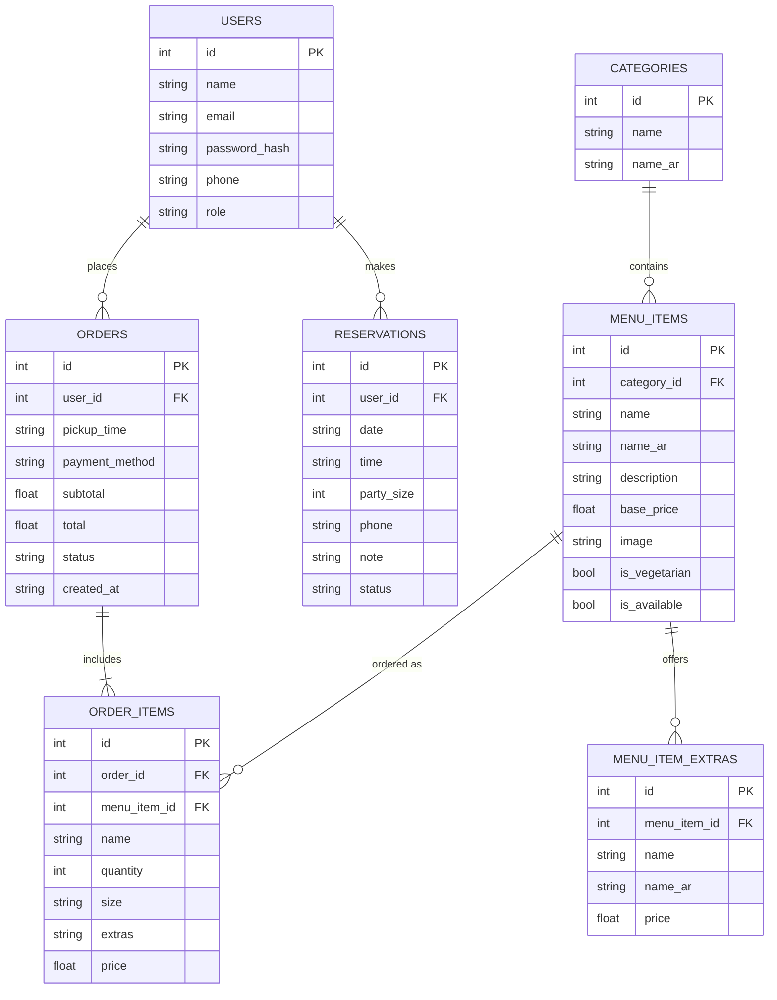

# ERD

GitHub renders this diagram automatically. Keep it in sync with `server/schema.sql`.

## Reading the diagram
- One user places many orders and makes many reservations.
- One category contains many dishes; one dish offers many extras.
- One order includes one or more order items. Each item points to a dish, but also keeps its own copy of the dish name and unit price.
- `ORDER_ITEMS.menu_item_id` can become empty if a dish is deleted; the copied `name` keeps the order readable.
