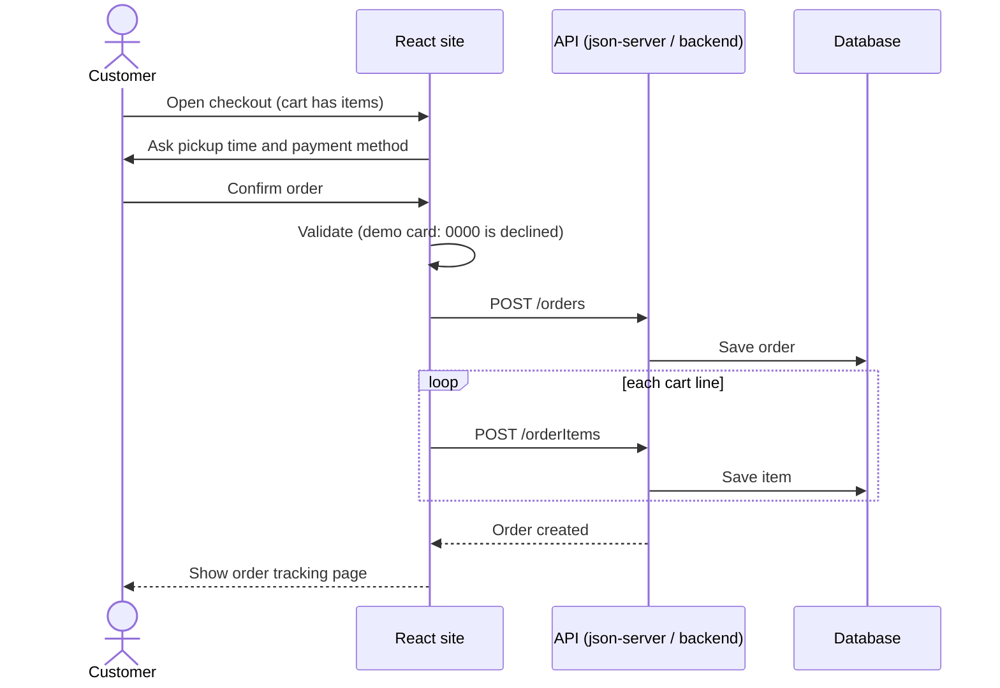

<!--
FILE      : docs/design/sequence-order.md
DEPI ITEM : System Analysis & Design - Sequence Diagram (place an order)
OWNER     : Shorouk (suggested - change if the team reassigns)
DUE       : 6 Nov 2026
WHAT TO DO:
  1. Check the steps against what the code really does, and add the error paths (declined card, unavailable dish).
Delete this comment block when the file is done.
-->

# Sequence Diagram: Place an Order

