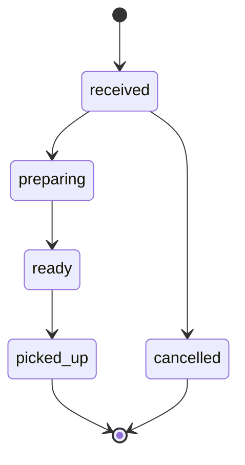
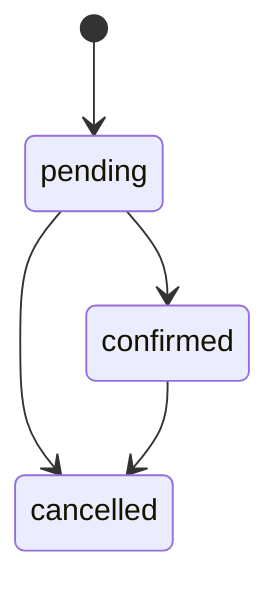

<!--
FILE      : docs/design/state-diagram.md
DEPI ITEM : System Analysis & Design - State Diagram
OWNER     : Shorouk (suggested - change if the team reassigns)
DUE       : 6 Nov 2026
WHAT TO DO:
  1. Required only if the instructor asks (DEPI lists it). Review the starter diagrams.
Delete this comment block when the file is done.
-->

# State Diagrams

## Order

## Reservation

