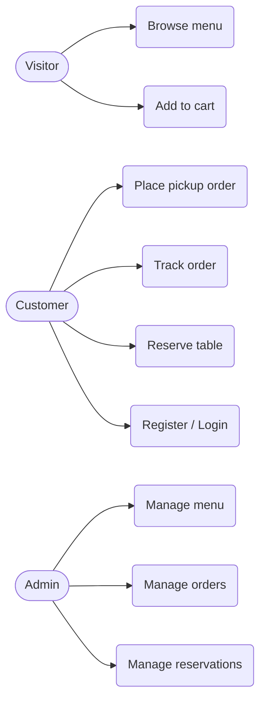

<!--
FILE      : docs/design/use-case.md
DEPI ITEM : System Analysis & Design - Use Case Diagram & Descriptions
OWNER     : Heba Talaat (suggested - change if the team reassigns)
DUE       : 6 Nov 2026
WHAT TO DO:
  1. Review and complete the starter diagram.
  2. Write a short description for each use case (actor, steps, result).
Delete this comment block when the file is done.
-->

# Use Case Diagram

## Use case descriptions
TODO: one short table per use case.
