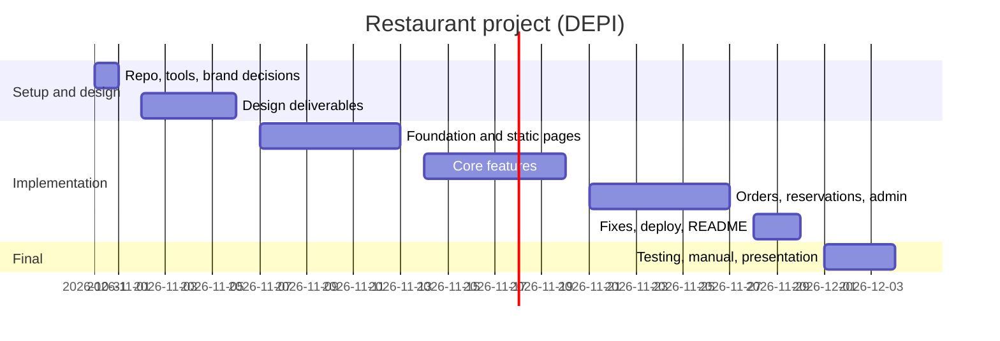

<!--
FILE      : docs/planning/project-plan.md
DEPI ITEM : Project Planning & Management - Project Plan (Gantt chart, milestones, deliverables, resources)
OWNER     : Heba Talaat (suggested - change if the team reassigns)
DUE       : 16 Oct 2026 (already passed - ask the instructor about late submission)
WHAT TO DO:
  1. Check the dates below against the real plan and adjust.
  2. Add one row per feature per person if you want a more detailed Gantt chart.
  3. Add resources: tools (GitHub, Figma, Netlify/Vercel), and who works on what.
SHORTCUT  : The content already exists in docs/planning/PROJECT_PLAN.docx (section 19 (timeline)): copy it here and improve it.
Delete this comment block when the file is done.
-->

# Project Plan

## Milestones
| Milestone | Date |
|---|---|
| Planning, literature review, requirements | 16 Oct 2026 (late) |
| System analysis and design | 6 Nov 2026 |
| Implementation (code + deployed link) | 30 Nov 2026 |
| Final presentation, testing, reports | 4 Dec 2026 |

## Gantt chart (GitHub renders this automatically)

## Deliverables and resources
TODO: list each deliverable with its owner, and the tools and accounts the team uses.
